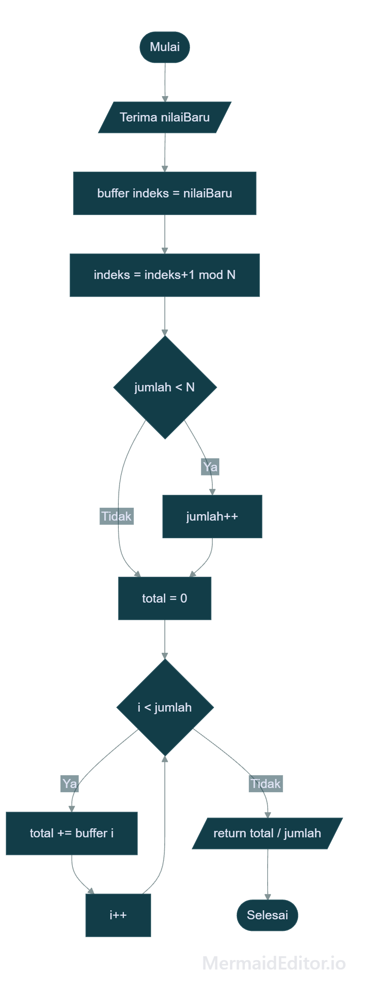
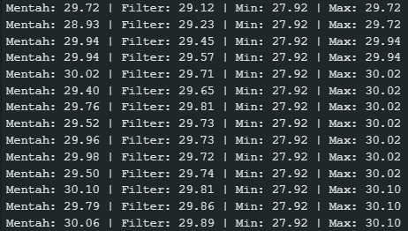
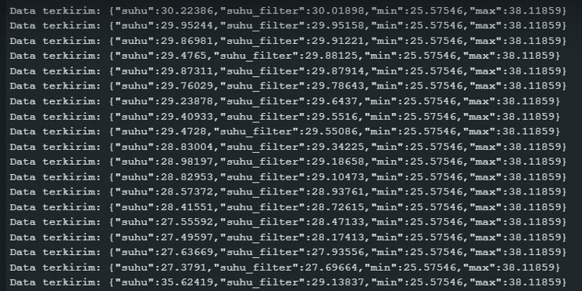
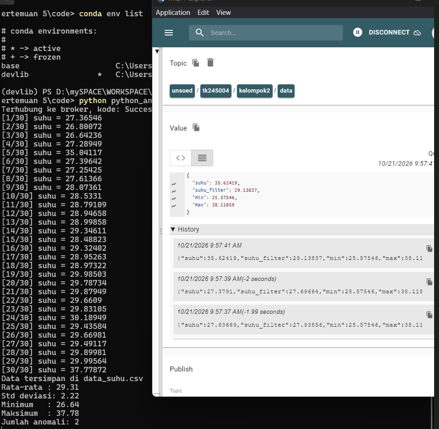
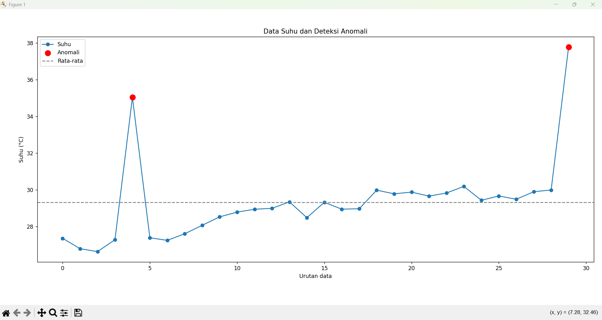

# Modul 5 - Pengolahan dan Analisis Data

Program 5A (Pengolahan Data Sensor pada ESP32/ESP8266) berfungsi untuk mengolah data sensor secara lokal di sisi *edge* (perangkat), meliputi pengimplementasian **filter moving average** untuk melembutkan fluktuasi/noise data, serta pencatatan nilai statistik dasar (minimum dan maksimum) secara *real-time*.

Program 5B (Akuisisi, Analisis, dan Visualisasi Data) berfungsi untuk melakukan akuisisi data sensor dari mikrokontroler melalui protokol **MQTT dengan format JSON**, kemudian memproses data tersebut di sisi *server/komputer* menggunakan Python untuk **penyimpanan ke CSV**, **analisis statistik**, **deteksi anomali berbasis z-score**, dan **visualisasi grafik**.

---

## Penjelasan Kode, Fungsi dan Percabangan pada Percobaan 5A (Pengolahan Data Sensor pada ESP32/ESP8266)

Program 5A mengeksekusi pengolahan data pada mikrokontroler menggunakan data sintetis dari fungsi *mock* pengganti sensor DHT22.

### Inisialisasi & Konfigurasi

* `const int N = 5;`: Menentukan jumlah sampel (*window size*) untuk algoritma *moving average*.
* `float buffer[N];`: Array penampung N nilai pembacaan terakhir.
* `int indeks = 0;`: Penunjuk posisi *ring buffer* untuk penulisan data baru.
* `int jumlah = 0;`: Menghitung jumlah sampel valid yang telah terisi (hingga batas maksimal N).
* `float suhuMin = 1000.0;` & `float suhuMax = -1000.0;`: Variabel penampung nilai minimum dan maksimum global.

### Fungsi `bacaSuhuMock()`

* `static unsigned long jumlahBaca = 0;`: Menyimpan jumlah iterasi pembacaan secara persisten antar pemanggilan fungsi.
* `float suhuDasar = 28.0 + 2.0 * sin(jumlahBaca * 0.08);`: Membangkitkan pola gelombang suhu sinus bertahap.
* `float noise = random(-5, 6) * 0.1;`: Menambahkan fluktuasi acak berskala kecil ($\pm 0.5^\circ\text{C}$).
* `if (jumlahBaca % 25 == 0) { suhu += 8.0; }`: **Percabangan** — Menambahkan lonjakan buatan $+8.0^\circ\text{C}$ setiap 25 kali pembacaan untuk mensimulasikan data anomali.

### Fungsi `hitungMovingAverage(float nilaiBaru)`

* `buffer[indeks] = nilaiBaru;`: Memasukkan data pembacaan baru ke posisi indeks buffer saat ini.
* `indeks = (indeks + 1) % N;`: Menggeser indeks penulisan melingkar (*ring buffer*).
* `if (jumlah < N) jumlah++;`: Menambah penghitung sampel sampai mencapai nilai N.
* `for (int i = 0; i < jumlah; i++) { total += buffer[i]; }`: Menjumlahkan seluruh isi buffer valid, lalu mengembalikan nilai rata-rata (`total / jumlah`).

### Fungsi `setup()` & `loop()`

* `Serial.begin(115200);`: Membuka komunikasi serial pada 115200 baud rate.
* `randomSeed(analogRead(0));`: Mengacak *seed* noise acak berdasarkan pembacaan pin analog mengambang.
* `if (isnan(suhu))`: **Percabangan** — Memeriksa kevalidan data sensor (mengabaikan pembacaan jika bernilai NaN).
* `if (suhu < suhuMin) suhuMin = suhu;` & `if (suhu > suhuMax) suhuMax = suhu;`: **Percabangan** — Memperbarui batasan ekstrem minimum dan maksimum.
* `delay(2000);`: Penundaan eksekusi loop selama 2000 ms (2 detik).

---

## Penjelasan Kode, Fungsi dan Percabangan pada Percobaan 5B (Akuisisi, Analisis, dan Visualisasi Data)

Percobaan 5B menggabungkan publikasi data JSON dari mikrokontroler dengan skrip analitis Python di komputer.

### Code Breakdown: Firmware ESP32/ESP8266

* `const char* topicData = "unsoed/tk245004/kelompok2/data";`: Topik MQTT target publikasi.
* `unsigned long waktuTerakhirPublish = 0;` & `const long intervalPublish = 2000;`: Variabel pewaktu *non-blocking* berbasis `millis()`.
* `JsonDocument doc;`: Menyusun dokumen JSON yang berisi *key* `"suhu"`, `"suhu_filter"`, `"min"`, dan `"max"`.
* `serializeJson(doc, buffer); client.publish(topicData, buffer);`: Mengonversi dan mengirimkan *payload* JSON ke broker MQTT.

### Code Breakdown: Skrip Python

* `on_connect(client, userdata, flags, reason_code, properties)`: Callback saat terhubung ke broker, melakukan `client.subscribe(TOPIC)`.
* `on_message(client, userdata, msg)`: Callback saat pesan MQTT masuk.
* `payload = json.loads(msg.payload.decode())`: Memparsing teks JSON menjadi dictionary Python.
* `data.append(...)`: Mengumpulkan data timestamp dan suhu hingga `JUMLAH_SAMPEL = 30`.
* `if len(data) >= JUMLAH_SAMPEL: client.disconnect()`: Memutuskan koneksi MQTT setelah target 30 sampel terpenuhi.


* **Pengolahan Pandas & Z-Score:**
* `df = pd.DataFrame(data)` & `df.to_csv("data_suhu.csv", index=False)`: Mengonversi data ke dataframe dan mengekspor ke file CSV.
* `rata2 = df["suhu"].mean()` & `std = df["suhu"].std()`: Menghitung statistik deskriptif populasi sampel.
* `df["zscore"] = (df["suhu"] - rata2) / std`: Menghitung Z-Score tiap poin data.
* `df["anomali"] = df["zscore"].abs() > 2`: Menandai status anomali jika $\vert{}z\vert{} > 2$.


* **Visualisasi Matplotlib:**
* `plt.plot(...)`: Menampilkan kurva tren suhu.
* `plt.scatter(anom.index, anom["suhu"], color="red", s=100)`: Menandai titik anomali dengan warna merah.
* `plt.axhline(rata2, ...)`: Menampilkan garis acuan rata-rata.


---

## Library / Dependencies

| Library / Dependency | Fungsi Utama |
| --- | --- |
| **ESP8266WiFi.h / WiFi.h** | Mengelola koneksi nirkabel ke jaringan Wi-Fi lokal. |
| **PubSubClient.h** | Mengimplementasikan klien protokol komunikasi MQTT. |
| **ArduinoJson.h** | Serialisasi data telemetry sensor ke format payload JSON. |
| **paho.mqtt.client (Python)** | Library klien MQTT untuk akuisisi data di komputer subscriber. |
| **pandas (Python)** | Manipulasi data tabular, kalkulasi statistik, ekspor CSV, dan hitung Z-Score. |
| **matplotlib.pyplot (Python)** | Pembuatan grafik linier dan plot sebaran anomali. |

---

## Pertanyaan Praktikum

### Percobaan 5A

1. **Gambarkan diagram alur (flowchart) proses perhitungan moving average pada fungsi `hitungMovingAverage()`!**
**Jawab:**
<br>


2. **Jelaskan fungsi dari operasi `(indeks + 1) % N` pada program tersebut!**
**Jawab:** Operasi `(indeks + 1) % N` berfungsi untuk membuat indeks buffer berputar kembali ke `0` setelah mencapai `N - 1`. Dengan demikian, buffer bekerja sebagai *ring buffer* (buffer melingkar) yang selalu menyimpan $N$ pembacaan terakhir. Ketika buffer sudah penuh, pembacaan baru akan menimpa data yang paling lama tanpa memerlukan pergeseran elemen array (*array shifting*).
3. **Apa dampaknya terhadap data hasil filter apabila nilai N diperbesar menjadi 20 atau diperkecil menjadi 2?**
**Jawab:**
* **Jika $N = 20$:** Data hasil filter menjadi sangat halus (*smooth*) karena merata-ratakan 20 pembacaan terakhir. Namun, respons terhadap perubahan suhu aktual menjadi lambat (*high lag*).
* **Jika $N = 2$:** Data hasil filter sangat responsif terhadap perubahan cepat, tetapi kurang efektif meredam *noise* karena hanya merata-ratakan dua pembacaan terakhir.


4. **Modifikasi program agar ESP32/ESP8266 juga menghitung simpangan baku dari data pada buffer.**
**Jawab:**

```cpp
// ==================== MOCK FUNCTION PENGGANTI SENSOR DHT22 ====================
float bacaSuhuMock() {
  static unsigned long jumlahBaca = 0;
  jumlahBaca++;

  float suhuDasar = 28.0 + 2.0 * sin(jumlahBaca * 0.08);
  float noise = random(-5, 6) * 0.1;
  float suhu = suhuDasar + noise;

  if (jumlahBaca % 25 == 0) {
    suhu += 8.0;
  }
  return suhu;
}

// ==================== MOVING AVERAGE & STATISTIK ====================
const int N = 5;
float buffer[N];
int indeks = 0;
int jumlah = 0;

float suhuMin = 1000.0;
float suhuMax = -1000.0;

float hitungMovingAverage(float nilaiBaru) {
  buffer[indeks] = nilaiBaru;
  indeks = (indeks + 1) % N;
  if (jumlah < N) jumlah++;

  float total = 0;
  for (int i = 0; i < jumlah; i++) {
    total += buffer[i];
  }
  return total / jumlah;
}

// ==================== FUNGSI SIMPANGAN BAKU ====================
float hitungSimpanganBaku() {
  if (jumlah == 0) return 0.0;

  float rata = 0.0;
  for (int i = 0; i < jumlah; i++) {
    rata += buffer[i];
  }
  rata /= jumlah;

  float varian = 0.0;
  for (int i = 0; i < jumlah; i++) {
    float selisih = buffer[i] - rata;
    varian += selisih * selisih;
  }
  varian /= jumlah;

  return sqrt(varian);
}

void setup() {
  Serial.begin(115200);
  randomSeed(analogRead(0));
}

void loop() {
  float suhu = bacaSuhuMock();

  if (isnan(suhu)) {
    Serial.println("Pembacaan gagal, data diabaikan");
  } else {
    float suhuFilter    = hitungMovingAverage(suhu);
    float simpanganBaku = hitungSimpanganBaku();

    if (suhu < suhuMin) suhuMin = suhu;
    if (suhu > suhuMax) suhuMax = suhu;

    Serial.print("Mentah: ");
    Serial.print(suhu);
    Serial.print(" | Filter: ");
    Serial.print(suhuFilter);
    Serial.print(" | Min: ");
    Serial.print(suhuMin);
    Serial.print(" | Max: ");
    Serial.print(suhuMax);
    Serial.print(" | Std: ");
    Serial.println(simpanganBaku);
  }

  delay(2000);
}

```

**Penjelasan Modifikasi Kode:**

| Baris Kode / Blok | Penjelasan |
| --- | --- |
| `float hitungSimpanganBaku()` | Mendefinisikan fungsi kalkulasi deviasi standar dari elemen aktif dalam `buffer`. |
| `if (jumlah == 0) return 0.0;` | Menjaga stabilitas eksekusi agar tidak terjadi error pembagian dengan nol (*divide-by-zero*). |
| `rata += buffer[i]; rata /= jumlah;` | Menghitung nilai rata-rata dari seluruh isi buffer aktif. |
| `float selisih = buffer[i] - rata; varian += selisih * selisih;` | Menghitung deviasi kuadrat tiap data terhadap rerata buffer. |
| `return sqrt(varian / jumlah);` | Mengembalikan nilai akar kuadrat varian sebagai simpangan baku buffer. |
| `Serial.print(" | Std: "); Serial.println(simpanganBaku);` | Mencetak parameter simpangan baku ke Serial Monitor bersama variabel statistik lainnya. |

---

### Percobaan 5B

1. **Jelaskan fungsi dari blok `try-except` pada fungsi `on_message()` dan apa yang terjadi apabila blok tersebut dihilangkan!**
**Jawab:** Blok `try-except` menangani error saat parsing format JSON dan pengambilan *key* `"suhu"`. Jika payload yang diterima bukan JSON valid atau tidak mengandung *key* target, exception ditangkap dan data tidak valid diabaikan. Jika dihilangkan, exception akan menghentikan callback MQTT dan berpotensi memutus *looping* `client.loop_forever()`, sehingga program Python *crash*.
2. **Jelaskan arti nilai z-score dan mengapa batas $\vert{}z\vert{} > 2$ digunakan sebagai penentu anomali!**
**Jawab:** Z-Score mengukur seberapa jauh suatu poin data menyimpang dari rata-rata dalam satuan standar deviasi ($z = \frac{x - \mu}{\sigma}$). Batas $\vert{}z\vert{} > 2$ digunakan karena pada Distribusi Normal, sekitar $95.4\%$ data berada dalam rentang $\pm 2\sigma$. Data yang berada di luar batas tersebut memuat probabilitas kemunculan $< 5\%$, sehingga dikategorikan sebagai anomali atau data ekstrem yang tidak wajar.
3. **Apa kelemahan metode z-score apabila data memiliki tren naik atau turun yang tajam?**
**Jawab:** Z-Score standar menggunakan statistik global ($\mu$ dan $\sigma$ dari seluruh dataset). Jika data memiliki tren tajam (non-stasioner), rentang standar deviasi menjadi sangat lebar atau bergeser, sehingga titik data awal/akhir tren dapat keliru teridentifikasi sebagai anomali, sedangkan lonjakan lokal berukuran sedang justru gagal terdeteksi.
4. **Modifikasi program agar menggunakan moving average jendela 5 data sebelum dihitung z-score, kemudian bandingkan jumlah anomali yang terdeteksi.**
**Jawab:**

```python
import json
import time
import paho.mqtt.client as mqtt
import pandas as pd
import matplotlib.pyplot as plt

BROKER = "broker.hivemq.com"
PORT = 1883
TOPIC = "unsoed/tk245004/kelompok2/data"
JUMLAH_SAMPEL = 30

data = []

def on_connect(client, userdata, flags, reason_code, properties):
    print("Terhubung ke broker, kode:", reason_code)
    client.subscribe(TOPIC)

def on_message(client, userdata, msg):
    try:
        payload = json.loads(msg.payload.decode())
        suhu = float(payload["suhu"])
    except (ValueError, KeyError):
        print("Data tidak valid, diabaikan")
        return

    data.append({"waktu": time.strftime("%Y-%m-%d %H:%M:%S"), "suhu": suhu})
    print(f"[{len(data)}/{JUMLAH_SAMPEL}] suhu = {suhu}")

    if len(data) >= JUMLAH_SAMPEL:
        client.disconnect()

# --- TAHAP 1: AKUISISI DATA MQTT ---
client = mqtt.Client(mqtt.CallbackAPIVersion.VERSION2)
client.on_connect = on_connect
client.on_message = on_message
client.connect(BROKER, PORT)
client.loop_forever()

# --- TAHAP 2: SIMPAN KE CSV ---
df = pd.DataFrame(data)
df.to_csv("data_suhu.csv", index=False)
print("Data tersimpan di data_suhu.csv")

# --- TAHAP 3A: Z-SCORE DATA ASLI ---
rata2_asli = df["suhu"].mean()
std_asli = df["suhu"].std()
df["zscore_asli"] = 0.0 if std_asli == 0 else (df["suhu"] - rata2_asli) / std_asli
df["anomali_asli"] = df["zscore_asli"].abs() > 2

# --- TAHAP 3B: MOVING AVERAGE (N=5) & Z-SCORE ---
df["suhu_ma"] = df["suhu"].rolling(window=5, min_periods=1).mean()
rata2_ma = df["suhu_ma"].mean()
std_ma = df["suhu_ma"].std()
df["zscore_ma"] = 0.0 if std_ma == 0 else (df["suhu_ma"] - rata2_ma) / std_ma
df["anomali_ma"] = df["zscore_ma"].abs() > 2

# --- TAHAP 4: PERBANDINGAN STATISTIK ---
print("\n===== STATISTIK DATA ASLI =====")
print(f"Rata-rata     : {rata2_asli:.2f}")
print(f"Std deviasi   : {std_asli:.2f}")
print(f"Jumlah anomali asli      : {df['anomali_asli'].sum()}")

print("\n===== STATISTIK DATA MOVING AVERAGE (N=5) =====")
print(f"Rata-rata     : {rata2_ma:.2f}")
print(f"Std deviasi   : {std_ma:.2f}")
print(f"Jumlah anomali Moving Avg: {df['anomali_ma'].sum()}")

selisih = df["anomali_asli"].sum() - df["anomali_ma"].sum()
print(f"\nSelisih anomali (Asli - MA): {selisih}")

# --- TAHAP 5: VISUALISASI PERBANDINGAN ---
plt.figure(figsize=(12, 5))
plt.plot(df.index, df["suhu"], marker="o", label="Suhu Asli", color="blue", alpha=0.6)
anom_asli = df[df["anomali_asli"]]
plt.scatter(anom_asli.index, anom_asli["suhu"], color="red", s=100, label="Anomali (Asli)", zorder=3)

plt.plot(df.index, df["suhu_ma"], marker="s", label="Moving Average (N=5)", color="green", linestyle="--")
anom_ma = df[df["anomali_ma"]]
plt.scatter(anom_ma.index, anom_ma["suhu_ma"], color="orange", s=120, marker="X", label="Anomali (MA)", zorder=3)

plt.xlabel("Urutan Data")
plt.ylabel("Suhu (°C)")
plt.title("Perbandingan Deteksi Anomali: Data Asli vs Moving Average (N=5)")
plt.legend()
plt.tight_layout()
plt.savefig("grafik_suhu_perbandingan.png")
plt.show()
```

---

## Pertanyaan Analisis

1. **Uraikan hasil tugas pada praktikum yang telah dilakukan pada setiap percobaan!**
**Jawab:**
* **Percobaan 5A:** ESP8266/ESP32 berhasil melakukan pengolahan data di sisi perangkat menggunakan moving average N = 5, serta mencatat nilai minimum dan maksimum. Data mentah dan data hasil filter ditampilkan ke Serial Monitor.
* **Percobaan 5B:** ESP8266/ESP32 berhasil mempublikasikan data suhu mock dalam format JSON ke broker MQTT. Program Python berhasil menerima 30 sampel, menyimpannya ke CSV, menghitung statistik, mendeteksi anomali dengan z-score, dan menampilkan grafik.


2. **Bandingkan pengolahan data di sisi perangkat (Percobaan 5A) dengan pengolahan data di sisi komputer (Percobaan 5B) dari segi kecepatan, kompleksitas analisis, dan kebutuhan sumber daya!**
**Jawab:**

* **Kecepatan:**: edge processing pada ESP lebih cepat untuk respons lokal karena data langsung diolah di perangkat. Server processing pada Python lebih lambat karena melibatkan pengiriman data melalui jaringan.

* **Kompleksitas:**: edge processing terbatas pada filter sederhana dan statistik dasar. Server processing mampu melakukan analisis lebih kompleks seperti pandas, z-score, visualisasi, dan penyimpanan historis.

* **Sumber Daya:**: ESP memiliki memori dan komputasi terbatas. Komputer memiliki sumber daya lebih besar sehingga cocok untuk analisis dan penyimpanan data dalam jumlah banyak.


3. **Bagaimana pengaruh pemilihan ukuran jendela moving average terhadap kualitas data dan kecepatan respons sistem kendali apabila data tersebut digunakan untuk mengendalikan aktuator?**
**Jawab:** Jendela besar menghasilkan data lebih halus dan stabil, tetapi respons terhadap perubahan menjadi lambat sehingga aktuator terlambat bereaksi. Jendela kecil menghasilkan respons lebih cepat, tetapi data lebih berisik dan dapat menyebabkan aktuator sering berubah status. Untuk sistem kendali, ukuran jendela harus disesuaikan dengan karakteristik sensor dan kebutuhan respons.

4. **Bagaimana hasil analisis dan deteksi anomali dapat dimanfaatkan untuk meningkatkan keandalan sistem IoT, misalnya pada sistem smart farming atau smart home?**
**Jawab:** Deteksi anomali dapat digunakan untuk mendeteksi sensor rusak, gangguan lingkungan, atau nilai tidak wajar. Pada smart farming, anomali suhu/kelembapan dapat memicu peringatan dini atau aktivasi irigasi. Pada smart home, anomali dapat digunakan untuk mendeteksi kebocoran gas, suhu berlebih, atau perilaku tidak normal. Dengan demikian, sistem dapat memberikan peringatan, melakukan tindakan otomatis, dan mengurangi risiko kesalahan keputusan.


---

## Kendala dan Solusi

1. **Kendala:** Sensor fisik DHT22 mengalami kendala operasi/kerusakan pada saat pelaksanaan praktikum laboratorium.
2. **Solusi:** Pembacaan data sensor fisik digantikan dengan mengimplementasikan fungsi generator pembacaan sintetis `bacaSuhuMock()` yang memodelkan tren suhu sinus, noise acak, dan lonjakan anomali buatan.

---

## Dokumentasi

### Percobaan 5A (Pengolahan Data Sensor pada ESP32/ESP8266)

**Serial Monitor Percobaan 5A:**
<br>

---

### Percobaan 5B (Akuisisi, Analisis, dan Visualisasi Data)

**Serial Monitor & Python MQTT Analysis Percobaan 5B:**
<br>
<br>
<br>